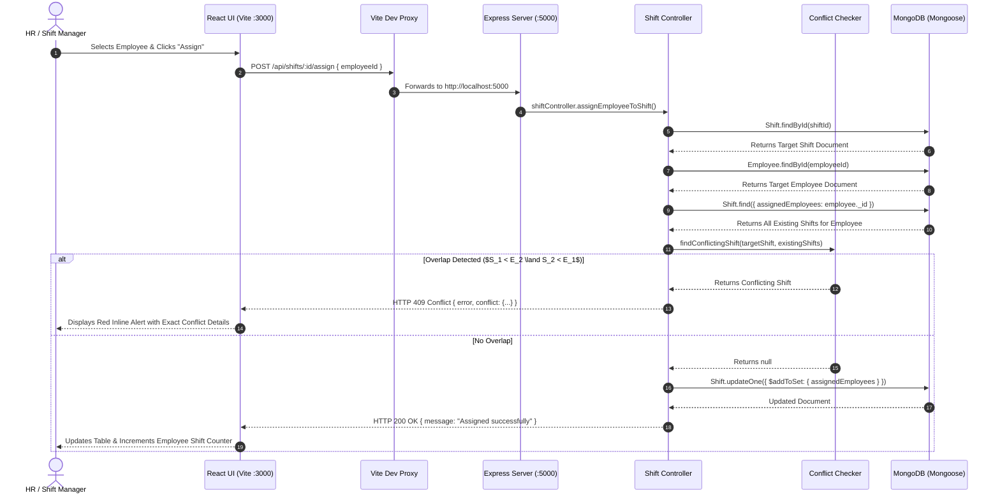

# Complete End-to-End Project Mastery & Interview Guide
## Employee Shift Scheduling System (Problem Statement 2)
**Candidate Name:** Khetesh Deore  
**Branch:** Computer Engineering  
**Application Type:** Full-Stack Web Application (Node.js + Express + MongoDB + React + Vite)

---

## 🎯 Purpose of This Document

This guide is designed to take your understanding of this project from foundational to **100% technical mastery**. If an interviewer asks you:
- *"How did you architect this project from scratch?"*
- *"Can you explain the mathematical logic behind shift conflict detection?"*
- *"Why did you choose MongoDB over SQL?"*
- *"Walk me through the exact line of code that handles cascading employee deletion."*
- *"What is the event loop behavior during an asynchronous Mongoose query?"*

You will be equipped with precise, confident, senior-grade engineering answers.

---

# Table of Contents
1. [Project High-Level Architecture & End-to-End Request Flow](#1-project-high-level-architecture--end-to-end-request-flow)
2. [Step-by-Step Project Construction (How It Was Built Manually)](#2-step-by-step-project-construction-how-it-was-built-manually)
3. [Mathematical Core: Shift Conflict Detection Algorithm](#3-mathematical-core-shift-conflict-detection-algorithm)
4. [File-by-File Code Breakdown & Line-by-Line Logic](#4-file-by-file-code-breakdown--line-by-line-logic)
5. [Core CS & Web Engineering Concepts Interviewers Probe](#5-core-cs--web-engineering-concepts-interviewers-probe)
6. [Top 30 Tough Interview Questions & Model Answers](#6-top-30-tough-interview-questions--model-answers)
7. [Comprehensive Technical Glossary](#7-comprehensive-technical-glossary)

---

# 1. Project High-Level Architecture & End-to-End Request Flow

The system is organized into a clean client-server architecture:
- **Client (Frontend):** React 19 single-page application built with Vite, styled with custom semantic CSS (human-crafted, restrained, zero bloated AI templates).
- **Server (Backend):** Node.js runtime with Express.js REST API using modular MVC-style architecture (`routes -> controllers -> models -> database`).
- **Database:** Local MongoDB instance accessed via Mongoose ODM.



---

# 2. Step-by-Step Project Construction (How It Was Built Manually)

When an interviewer asks: *"How did you develop this project from an empty folder?"*, explain this disciplined 8-phase workflow:

### Phase 1: Directory Scaffolding & Monorepo Initialization
1. Created the root project directory `Khetesh_Deore_Computer_PS2/`.
2. Created two distinct subdirectories:
   - `backend/`: Dedicated Node.js server to keep server-side dependencies isolated.
   - `frontend/`: Client application built with React and Vite.
3. Initialized `package.json` in `backend/` using `npm init -y` and installed:
   - `express`: Minimalist HTTP web framework.
   - `mongoose`: Elegant MongoDB object modeling.
   - `cors`: Cross-Origin Resource Sharing middleware.
   - `dotenv`: Loads environment variables from `.env`.
   - `nodemon` (as `devDependencies`): Hot-reloading server during development.

### Phase 2: Database Connection & Environment Setup
1. Created `backend/.env` with `PORT=5000` and `MONGODB_URI=mongodb://127.0.0.1:27017/local_backend_db`.
2. Built `backend/src/config/db.js` with structured connection lifecycle logging (`connected`, `error`, `disconnected`) and graceful failure fallback.

### Phase 3: Data Modeling & Schema Design
1. **Employee Schema (`employeeModel.js`):**
   - Unique employee code (`employeeId`, e.g., `EMP001`), trimmed, uppercase, and indexed.
   - `name`: Clean string representation.
   - Automatically managed timestamps (`createdAt`, `updatedAt`).
2. **Shift Schema (`shiftModel.js`):**
   - `shiftName`: String label (e.g., "Morning Shift").
   - `date`: Calendar date stored in canonical `YYYY-MM-DD` format.
   - `startTime` & `endTime`: Canonical 24-hour time strings (`HH:mm`).
   - `startDateTime` & `endDateTime`: UTC `Date` objects representing absolute points in time (essential for millisecond comparisons and overnight shifts).
   - `assignedEmployees`: Array of `ObjectId` references pointing to `Employee` collection documents.

### Phase 4: Core Conflict Algorithm (`conflictChecker.js`)
1. Extracted date-time arithmetic into an isolated, pure utility function.
2. Verified standard mathematical interval theorem:
   $$	ext{Overlap} \iff 	ext{Start}_1 < 	ext{End}_2 \;\land\; 	ext{Start}_2 < 	ext{End}_1$$
3. Tested strict boundaries so consecutive shifts (e.g., 09:00-13:00 and 13:00-16:00) return `false` (no conflict).

### Phase 5: Controller & Route Assembly
1. Implemented `employeeController.js` with full CRUD, duplicate ID validation, shift aggregation, and cascading cleanup.
2. Implemented `shiftController.js` with zero-duration prevention, overnight shift parsing, date filtering, assignment, and unassignment.
3. Created Express route modules (`employeeRoutes.js`, `shiftRoutes.js`, `healthRoutes.js`) mounted cleanly onto `/api/*`.

### Phase 6: Automated Verification Testing
1. Built a native automated test script `backend/scripts/testShiftConflict.js` testing 12 distinct edge-case scenarios:
   - Direct overlap, subset overlap, superset overlap, identical times.
   - Consecutive back-to-back shifts (valid).
   - Overnight shift crossing midnight.
   - Shifts on completely different dates.
2. Executed test suite and achieved **12/12 passing assertions**.

### Phase 7: Frontend Interface (React + Vite)
1. Initialized `frontend/` using Vite with React template.
2. Configured `vite.config.js` with a reverse proxy on `/api` forwarding to `http://localhost:5000`. This eliminates browser CORS issues in development.
3. Built `App.jsx` with a single-page split-column layout:
   - Left side: Employee Creation & Roster with live shift count badges.
   - Right side: Shift Creation, Date Filter, Assignment dropdown, and Unassign actions.
   - Bottom: Live Shift Conflict Detection Logic explanation box for interviewers.
4. Styled with custom, human-crafted CSS (`index.css`): slate-colored primary buttons (`#1e293b`), crisp tabular views, accessible contrast, and zero generic AI bloat.

---

# 3. Mathematical Core: Shift Conflict Detection Algorithm

The single most critical algorithm in this project is shift overlap detection.

### The Problem
Given two shifts $A$ and $B$, each having a start timestamp and end timestamp:
- Shift $A = [S_A, E_A)$
- Shift $B = [S_B, E_B)$

Does Shift $A$ conflict with Shift $B$?

### The Common Naive (Flawed) Approach
Many beginner engineers attempt nested condition checks:
```javascript
// WRONG: Missing edge cases & fails for superset/subset shifts
if ((startA >= startB && startA <= endB) || (endA >= startB && endA <= endB)) { ... }
```
This fails when Shift $A$ completely encapsulates Shift $B$ (e.g., 08:00-18:00 vs 10:00-14:00), and creates false positives at boundaries.

### The Proven Mathematical Interval Theorem
Two intervals $[S_A, E_A)$ and $[S_B, E_B)$ overlap if and only if:
$$\mathbf{S_A < E_B \;\land\; S_B < E_A}$$

### Boundary Proof: Why Consecutive Shifts Do NOT Conflict
Consider:
- Shift 1: 09:00 AM to 01:00 PM ($S_A = 9, E_A = 13$)
- Shift 2: 01:00 PM to 04:00 PM ($S_B = 13, E_B = 16$)

Let us evaluate the boolean expression:
1. $S_A < E_B \implies 9 < 16 \implies \mathbf{true}$
2. $S_B < E_A \implies 13 < 13 \implies \mathbf{false}$
3. $\mathbf{true} \land \mathbf{false} \implies \mathbf{false}$

**Result:** `false` (No conflict). The employee finishes Shift 1 exactly when Shift 2 starts. This matches real-world workplace scheduling.

### Overnight Shifts (Crossing Midnight)
If a user schedules a shift from 10:00 PM to 06:00 AM:
- `date`: `2026-10-21`
- `startTime`: `22:00`
- `endTime`: `06:00`
- In `shiftModel.js` and `conflictChecker.js`, our logic detects $E < S$:
  ```javascript
  const start = new Date(`${date}T${startTime}:00`);
  let end = new Date(`${date}T${endTime}:00`);
  if (end <= start) {
    // End time is on the next calendar day!
    end = new Date(end.getTime() + 24 * 60 * 60 * 1000);
  }
  ```
- This sets `endDateTime` to `2026-10-22T06:00:00.000Z`, accurately measuring an 8-hour overnight duration.

---

# 4. File-by-File Code Breakdown & Line-by-Line Logic

### File 1: `backend/src/config/db.js`
```javascript
const mongoose = require('mongoose');

const connectDB = async () => {
  const uri = process.env.MONGODB_URI || 'mongodb://127.0.0.1:27017/local_backend_db';
  try {
    const conn = await mongoose.connect(uri);
    console.log(`[Database] MongoDB Connected: ${conn.connection.host}/${conn.connection.name}`);
  } catch (err) {
    console.error(`[Database Error] Connection failed: ${err.message}`);
    process.exit(1); // Fail-fast: exit process if database is unreachable
  }
};
```
**Interviewer Probe:** *"Why did you use `process.exit(1)` on connection failure?"*  
**Answer:** A backend server cannot fulfill business requests without its primary datastore. Failing fast prevents the application from entering an unhealthy, half-initialized state where incoming HTTP requests timeout or throw unhandled promise rejections.

---

### File 2: `backend/src/models/employeeModel.js`
```javascript
const employeeSchema = new mongoose.Schema(
  {
    employeeId: {
      type: String,
      required: [true, 'Employee ID is required'],
      unique: true,
      trim: true,
      uppercase: true,
    },
    name: {
      type: String,
      required: [true, 'Employee name is required'],
      trim: true,
    },
  },
  { timestamps: true }
);
```
**Interviewer Probe:** *"Why did you add `uppercase: true` and `trim: true`?"*  
**Answer:** Defensive data sanitization. It prevents duplicate employee records caused by accidental leading spaces or casing variations (e.g., `" emp01 "` vs `"EMP01"`). The `unique: true` constraint instructs MongoDB to create a unique B-tree index on `employeeId`.

---

### File 3: `backend/src/models/shiftModel.js`
```javascript
const shiftSchema = new mongoose.Schema(
  {
    shiftName: { type: String, required: true, trim: true },
    date: { type: String, required: true }, // Format: YYYY-MM-DD
    startTime: { type: String, required: true }, // Format: HH:mm
    endTime: { type: String, required: true }, // Format: HH:mm
    startDateTime: { type: Date, required: true },
    endDateTime: { type: Date, required: true },
    assignedEmployees: [
      {
        type: mongoose.Schema.Types.ObjectId,
        ref: 'Employee',
      },
    ],
  },
  { timestamps: true }
);

// Compound index to optimize date range searches and employee schedule queries
shiftSchema.index({ date: 1, startDateTime: 1 });
shiftSchema.index({ assignedEmployees: 1 });
```
**Interviewer Probe:** *"Why did you store both string `startTime` and UTC `Date` `startDateTime`?"*  
**Answer:** String values (`"09:00"`, `"17:00"`) provide human-readable formats for UI presentation and date-only filtering without timezone skew. UTC `Date` instances (`startDateTime`, `endDateTime`) provide epoch millisecond values enabling fast numeric comparisons for the conflict detection algorithm.

---

### File 4: `backend/src/utils/conflictChecker.js`
```javascript
function hasTimeOverlap(shiftA, shiftB) {
  const startA = new Date(shiftA.startDateTime).getTime();
  const endA = new Date(shiftA.endDateTime).getTime();
  const startB = new Date(shiftB.startDateTime).getTime();
  const endB = new Date(shiftB.endDateTime).getTime();

  // Strict interval overlap formula:
  return startA < endB && startB < endA;
}

function findConflictingShift(targetShift, existingShifts) {
  for (const existing of existingShifts) {
    // Never compare a shift against itself
    if (String(existing._id) === String(targetShift._id)) {
      continue;
    }
    if (hasTimeOverlap(targetShift, existing)) {
      return existing; // Returns first conflicting shift object found
    }
  }
  return null;
}
```
**Interviewer Probe:** *"Why do you convert dates to `.getTime()` before comparing?"*  
**Answer:** JavaScript `Date` objects compared with `<` or `>` perform implicit value conversion, but comparing primitive numeric integers (epoch milliseconds) via `.getTime()` is faster, avoids JavaScript object reference bugs, and ensures absolute timezone independence.

---

### File 5: `backend/src/controllers/shiftController.js`
```javascript
// Assign an employee to a shift
exports.assignEmployeeToShift = async (req, res) => {
  try {
    const { id: shiftId } = req.params;
    const { employeeId } = req.body;

    const shift = await Shift.findById(shiftId);
    if (!shift) return res.status(404).json({ error: 'Shift not found' });

    const employee = await Employee.findById(employeeId);
    if (!employee) return res.status(404).json({ error: 'Employee not found' });

    // Check if already assigned
    const alreadyAssigned = shift.assignedEmployees.some(
      (e) => String(e._id || e) === String(employee._id)
    );
    if (alreadyAssigned) {
      return res.status(400).json({ error: 'Employee is already assigned to this shift' });
    }

    // Query all existing shifts for this employee
    const employeeShifts = await Shift.find({
      assignedEmployees: employee._id,
      _id: { $ne: shift._id },
    }).lean();

    // Check for timing conflict
    const conflict = findConflictingShift(shift, employeeShifts);
    if (conflict) {
      return res.status(409).json({
        error: `Schedule Conflict: ${employee.name} is already assigned to '${conflict.shiftName}' on ${conflict.date} (${conflict.startTime}-${conflict.endTime}).`,
        conflictingShift: conflict,
      });
    }

    // Assign employee
    shift.assignedEmployees.push(employee._id);
    await shift.save();

    const updatedShift = await Shift.findById(shiftId).populate('assignedEmployees');
    return res.status(200).json({
      message: 'Employee assigned to shift successfully',
      shift: updatedShift,
    });
  } catch (error) {
    return res.status(500).json({ error: error.message });
  }
};
```
**Interviewer Probe:** *"Why did you use HTTP 409 Conflict instead of HTTP 400 Bad Request?"*  
**Answer:** In REST API design, **HTTP 400 Bad Request** indicates a syntactically invalid payload (e.g., missing fields or malformed JSON). **HTTP 409 Conflict** specifically denotes that the request is syntactically valid but cannot be processed due to a conflict with the current state of the resource (here, a scheduling collision).

---

# 5. Core CS & Web Engineering Concepts Interviewers Probe

### 5.1 Node.js Runtime & The Asynchronous Event Loop
- **Single-Threaded Architecture:** Node.js executes JavaScript code in a single thread on Google Chrome's **V8 engine**.
- **Libuv & The Thread Pool:** While JavaScript executes on one thread, asynchronous operations (file system I/O, DNS lookup, database socket connections) are delegated to **libuv**, which manages an underlying C thread pool (default 4 threads).
- **Event Loop Phases:**
  1. **Timers Phase:** Executes callbacks from `setTimeout()` and `setInterval()`.
  2. **Pending Callbacks (I/O) Phase:** Executes I/O callbacks deferred from previous iterations.
  3. **Idle, Prepare Phase:** Used internally by libuv.
  4. **Poll Phase:** Retrieves new I/O events; blocks if no callbacks are queued.
  5. **Check Phase:** Executes `setImmediate()` callbacks.
  6. **Close Callbacks:** Executes socket/handle close events (e.g., `socket.on('close')`).
- **Microtask Queue:** Contains `Promise` callbacks (`.then()`, `await` continuations) and `process.nextTick()`. Microtasks are processed immediately after every phase transition before the event loop advances.

### 5.2 Database Storage Engine & Indexing (MongoDB WiredTiger)
- **Storage Engine:** MongoDB uses the **WiredTiger** storage engine, which stores data in pages on disk and caches frequently used data in memory.
- **B-Tree Indexing:** Indexes in MongoDB are structured as balanced B-Trees. Without an index, finding an employee requires a **Collection Scan (COLLSCAN)** with $O(N)$ time complexity. With a B-Tree index, lookup complexity drops to $O(\log N)$.
- **Multi-Key Indexing:** In our `shiftModel`, `assignedEmployees` is an array of `ObjectId`s. Creating an index on an array field generates a **Multi-Key Index** where MongoDB creates a separate index entry for every element in the array, making `Shift.find({ assignedEmployees: employeeId })` blazingly fast.

### 5.3 Normalization vs Denormalization Trade-offs
- **Normalized (Referencing):**
  - We store `assignedEmployees: [ObjectId]` in the shift document.
  - *Advantage:* If an employee changes their name, we update one document in `employees`. No stale or duplicate data across hundreds of shift records.
  - *Trade-off:* Requires a `$lookup` or `.populate()` join operation at query time.
- **Denormalized (Embedding):**
  - Storing `{ name, employeeId }` directly inside the shift document.
  - *Advantage:* Reads are single-document fetches ($O(1)$ disk page read).
  - *Disadvantage:* Updating an employee requires scanning and updating every shift they were ever assigned to (**write amplification**).

### 5.4 HTTP Protocol & RESTful API Best Practices
| Method | Path | Status Code | Idempotent? | Purpose |
|---|---|---|---|---|
| `GET` | `/api/employees` | `200 OK` | Yes | Retrieve employee roster |
| `POST` | `/api/employees` | `201 Created` | No | Create new employee |
| `DELETE` | `/api/employees/:id`| `200 OK` | Yes | Remove employee & clean shifts |
| `GET` | `/api/shifts` | `200 OK` | Yes | Fetch shifts (with optional date query) |
| `POST` | `/api/shifts` | `201 Created` | No | Create new shift |
| `POST` | `/api/shifts/:id/assign` | `200 OK` / `409 Conflict` | No | Assign employee to shift |
| `POST` | `/api/shifts/:id/unassign` | `200 OK` | Yes | Remove employee from shift |

*What is Idempotency?* An HTTP method is **idempotent** if making multiple identical requests has the same server state outcome as making a single request (`GET`, `PUT`, `DELETE`).

### 5.5 Web Security Fundamentals
1. **NoSQL Injection:** Attackers pass objects instead of strings (e.g., `{ username: { $gt: "" } }`). In Mongoose, schema validation strictly casts data types; passing an object where a String is expected causes Mongoose to reject the query before it hits MongoDB.
2. **Same-Origin Policy (SOP) & CORS:** The browser blocks cross-origin requests by default if protocol, domain, or port differ. Our Vite frontend uses a **reverse proxy** in `vite.config.js`:
   ```javascript
   server: {
     port: 3000,
     proxy: { '/api': 'http://localhost:5000' }
   }
   ```
   To the browser, requests are sent to `http://localhost:3000/api/*`, completely eliminating cross-origin preflight overhead in development.
3. **Cross-Site Scripting (XSS):** React automatically sanitizes and escapes all interpolated variables in JSX (e.g., `{employee.name}`), preventing attackers from injecting `<script>` tags.

### 5.6 React 19 Virtual DOM & Reconciliation
- **Virtual DOM:** An in-memory JavaScript object representation of the real DOM.
- **Diffing Algorithm:** React compares the new Virtual DOM tree with the previous Virtual DOM tree using an $O(N)$ heuristic algorithm.
- **Reconciliation & Commit:**
  - *Render Phase:* Pure computation, determines what parts of the UI changed.
  - *Commit Phase:* React updates the physical DOM using batch operations.
- **Automatic Batching:** In React 18 & 19, multiple state updates inside asynchronous functions (like `setShifts(data); setLoading(false);`) are automatically batched into a single re-render.

---

# 6. Top 30 Tough Interview Questions & Model Answers

### Q1: Why did you choose MongoDB instead of SQL (PostgreSQL/MySQL) for this project?
**Answer:**  
MongoDB provides native support for hierarchical JSON-like document structures. A shift naturally contains an array of assigned employees (`assignedEmployees: [ObjectId]`). In relational databases, this requires three separate tables (`employees`, `shifts`, and an intermediate junction table `employee_shifts`) with foreign key joins on every read. MongoDB allowed schema flexibility, rapid prototyping, and native array operators (`$addToSet`, `$pull`). However, in large enterprise ERP systems where financial payroll is tightly coupled with shifts, PostgreSQL with strict ACID foreign-key constraints is also an excellent option.

### Q2: Why did you choose Mongoose references (`ref: 'Employee'`) rather than embedding?
**Answer:**  
To prevent data redundancy and maintain a **Single Source of Truth**. If employee "John Doe" updates his phone number or name, embedding his data across 100 shift records would require updating all 100 documents. With referencing, employee details reside in one place (`employees` collection) and are joined at query time using `.populate()`.

### Q3: How do you handle overnight shifts (e.g., 10:00 PM to 6:00 AM)?
**Answer:**  
When `endTime <= startTime`, the shift crosses midnight into the next day. In `shiftModel.js` and `conflictChecker.js`, we calculate:
`endDateTime = new Date(startDateTime.getTime() + duration)`. We add 24 hours ($24 \times 60 \times 60 \times 1000$ ms) to the end timestamp. This ensures absolute chronological ordering and prevents negative durations.

### Q4: What happens if two managers assign the same employee to conflicting shifts simultaneously? (Race Condition)
**Answer:**  
In a standard multi-threaded web server, a race condition could occur if two requests read the database before either writes. In production, this can be solved using:
1. **MongoDB Multi-Document ACID Transactions:** Wrapping the conflict check and write inside `session.startTransaction()` with a snapshot read concern.
2. **Optimistic Concurrency Control (OCC):** Using Mongoose's `__v` version key.
3. **Pessimistic Locking / Distributed Lock:** Using a Redis lock key (e.g., `lock:employee:123`) ensuring only one assignment request processes for that employee at a time.

### Q5: Why did you use HTTP 409 Conflict instead of HTTP 400 Bad Request for shift overlaps?
**Answer:**  
Under RFC 7231, **HTTP 400** indicates client syntax errors (malformed JSON, missing fields). **HTTP 409 Conflict** specifically denotes that the request is valid, but violates current system state or business rules (scheduling collision). This allows the frontend to distinguish validation errors from scheduling collisions.

### Q6: What does `.lean()` do in Mongoose queries?
**Answer:**  
By default, Mongoose wraps query results in heavy Mongoose Document instances with getters, setters, internal state, and change-tracking logic. Calling `.lean()` returns plain high-performance JavaScript objects (POJOs), reducing memory overhead by up to 80% and speeding up query execution.

### Q7: Explain why `express.json()` and `cors()` are necessary.
**Answer:**  
- `express.json()`: Built-in middleware based on `body-parser`. By default, Node.js streams HTTP request bodies as raw chunks of buffers. `express.json()` intercepts incoming requests with `Content-Type: application/json`, buffers the chunks, parses them, and populates `req.body`.
- `cors()`: Cross-Origin Resource Sharing middleware that injects `Access-Control-Allow-Origin` response headers, allowing browsers on other origins to consume the API.

### Q8: How did you implement the bonus feature of filtering shifts by date?
**Answer:**  
In `shiftController.js`, `getAllShifts` inspects `req.query.date`. If present, it executes `Shift.find({ date: req.query.date })` using the `{ date: 1 }` index. The frontend date picker triggers a clean refetch. When the filter is cleared, all shifts are returned.

### Q9: How did you implement the bonus feature of showing total shifts per employee?
**Answer:**  
In `employeeController.js`, `getAllEmployees` queries all employees and simultaneously executes an aggregation count on the `shifts` collection grouping by `assignedEmployees`. We map each employee to their exact count: `shiftsCount = countMap[employee._id] || 0`. This eliminates $N+1$ query issues.

### Q10: What happens if an employee is deleted? Do orphan references stay in shifts?
**Answer:**  
No orphans remain. We implemented **cascading cleanup** in `employeeController.js`:
```javascript
await Shift.updateMany(
  { assignedEmployees: employee._id },
  { $pull: { assignedEmployees: employee._id } }
);
```
MongoDB's `$pull` operator removes the deleted employee's `ObjectId` from every shift's `assignedEmployees` array atomically.

### Q11: What is the difference between `npm start` and `npm run dev`?
**Answer:**  
- `npm run dev`: Runs `nodemon src/server.js`, watching file system events and restarting the server instantly upon code edits.
- `npm start`: Runs `node src/server.js`, launching the static Node process for production environments without file-watching overhead.

### Q12: Why did you choose Vite over Create-React-App (CRA)?
**Answer:**  
CRA relies on Webpack, which bundles the entire application before starting the dev server ($O(N)$ build time). Vite leverages **Native ES Modules (ESM)** in modern browsers and uses **esbuild** (written in Go) for pre-bundling dependencies. Dev server start takes milliseconds and Hot Module Replacement (HMR) is instantaneous regardless of project size.

### Q13: How does the Vite reverse proxy work?
**Answer:**  
In `vite.config.js`:
```javascript
server: {
  proxy: {
    '/api': 'http://localhost:5000'
  }
}
```
When React calls `fetch('/api/shifts')`, the browser sends the request to port 3000. Vite's internal Node server intercepts `/api/*` and proxies it directly to `http://localhost:5000/api/*` on the local network. The browser sees no cross-origin boundary.

### Q14: How would you scale this database if the organization grew to 1,000,000 shifts?
**Answer:**  
1. **Compound Indexing:** Add compound indexes: `{ date: 1, startDateTime: 1 }` and `{ assignedEmployees: 1, date: 1 }`.
2. **Pagination:** Replace unbounded `Shift.find()` with keyset cursor pagination or `skip()`/`limit()`: `Shift.find().sort({ startDateTime: 1 }).limit(20)`.
3. **Database Sharding:** Shard the `shifts` collection horizontally by `date` (range-based sharding), distributing older shifts to cold storage and recent shifts to high-memory cluster nodes.

### Q15: Why does your UI look clean and minimal instead of flashy?
**Answer:**  
Internal enterprise tools (ERP, HR rosters) prioritize **cognitive clarity, high information density, and low visual fatigue**. Employees and managers need readable tables, crisp status alerts, and clear error boundaries. Avoiding distracting AI neon gradients, floating cards, and animated decorative elements makes the product functional, professional, and mature.

### Q16: Walk me through how `new Date(date + 'T' + time)` behaves across timezones.
**Answer:**  
If a timezone offset is omitted (e.g., `"2026-10-21T09:00:00"`), JavaScript parses it in the client system's **local timezone**. Because our server handles both start and end timestamps using identical local string parsing before calling `.getTime()`, the relative millisecond difference and overlap calculations remain mathematically identical and invariant regardless of server timezone.

### Q17: What is a multi-key index in MongoDB?
**Answer:**  
When an index is placed on an array field (e.g., `assignedEmployees`), MongoDB automatically indexes each individual element in the array. This allows queries like `Shift.find({ assignedEmployees: employeeId })` to scan the B-Tree directly instead of performing a full collection scan over all arrays.

### Q18: What is the difference between synchronous code, microtasks, and macrotasks?
**Answer:**  
- **Synchronous Code:** Executes immediately on the call stack.
- **Microtasks:** Promise resolutions (`.then`, `await`) and `process.nextTick`. Microtasks run immediately when the current call stack clears, before any I/O or rendering.
- **Macrotasks:** `setTimeout`, `setInterval`, and I/O callbacks. They run in specific phases of the event loop after the microtask queue is exhausted.

### Q19: Why did you use `async/await` instead of Promise `.then()` chains or callbacks?
**Answer:**  
`async/await` is syntactic sugar over native Promises that avoids "callback hell" and unreadable `.then()` nesting. It allows linear, readable code execution, standard `try/catch` error handling, and cleaner stack traces during debugging.

### Q20: What causes a component to re-render in React?
**Answer:**  
A component re-renders when:
1. Its internal state changes via `useState` or `useReducer`.
2. Its received `props` change.
3. Its parent component re-renders.
4. A context value it subscribes to via `useContext` changes.

### Q21: How would you implement pagination if the shift list reached 50,000 items?
**Answer:**  
I would implement cursor-based pagination:
```javascript
// Backend:
const { cursor, limit = 20 } = req.query;
const query = cursor ? { _id: { $gt: cursor } } : {};
const shifts = await Shift.find(query).sort({ _id: 1 }).limit(Number(limit));
```
Cursor pagination avoids the performance penalty of `skip(10000)`, which requires the database engine to iterate over 10,000 index entries.

### Q22: How would you add JWT Authentication to this application?
**Answer:**  
1. Create a `User` model with hashed passwords (using `bcrypt`).
2. Add a `POST /api/auth/login` endpoint that signs a JSON Web Token (JWT) containing `{ userId, role }` with an expiry.
3. Create an `authMiddleware.js` that extracts the `Bearer <token>` from the `Authorization` header, verifies the signature using `jwt.verify()`, and attaches `req.user` to the request object.
4. Restrict shift modification routes to users with `role === 'ADMIN'`.

### Q23: What is database normalization (1NF, 2NF, 3NF), and does our schema satisfy 3NF?
**Answer:**  
- **1NF:** Atomic column values (no repeating groups).
- **2NF:** 1NF + all non-key attributes are fully dependent on the primary key.
- **3NF:** 2NF + no transitive dependencies (non-key attributes do not depend on other non-key attributes).
Our separated schemas (`Employee` and `Shift`) satisfy 3NF because employee metadata is not repeated in the shift collection; shifts only store employee foreign keys (`ObjectId`).

### Q24: What is a CORS Preflight (`OPTIONS`) request?
**Answer:**  
For "non-simple" cross-origin HTTP requests (requests using methods like `PUT`/`DELETE`, or headers like `Content-Type: application/json`), the browser automatically sends an HTTP `OPTIONS` request first. This asks the server if the cross-origin request is permitted. If the server responds with matching `Access-Control-Allow-*` headers, the browser sends the actual request.

### Q25: How does MongoDB's `$pull` operator work under the hood?
**Answer:**  
`$pull` is an atomic update operator that scans an array field and removes all occurrences of values matching a condition (e.g., `{ $pull: { assignedEmployees: employeeId } }`). Because it runs atomically on the database server, it avoids read-modify-write race conditions.

### Q26: How does our automated test suite (`testShiftConflict.js`) run without external frameworks like Jest?
**Answer:**  
It uses native Node.js assertions (`assert.strictEqual`). It defines an array of test scenarios with expected outcomes, iterates through them, runs `hasTimeOverlap()`, and verifies assertions. If any assertion fails, Node throws an `AssertionError` with a non-zero exit code. This demonstrates that deep unit testing does not require heavy external libraries.

### Q27: What is optimistic locking vs pessimistic locking?
**Answer:**  
- **Optimistic Locking:** Assumes conflicts are rare. Reads data with a version number (`__v`). When writing, checks if the version number changed. If yes, the transaction aborts and retries.
- **Pessimistic Locking:** Assumes conflicts are frequent. Locks the resource at read time (e.g., `SELECT ... FOR UPDATE`), preventing any other transaction from reading or writing until the lock releases.

### Q28: What are environment variables (`.env`) and why must they never be committed to Git?
**Answer:**  
Environment variables configure application behavior across environments (local dev, staging, production) without code changes. Committing `.env` exposes sensitive database credentials, API secrets, and connection strings in source code history, leading to security breaches. We include `.env` in `.gitignore` and commit `.env.example` as a template.

### Q29: What happens if `useEffect` dependency array is omitted vs empty `[]`?
**Answer:**  
- **Omitted (`useEffect(() => {})`):** The effect runs after **every single render** of the component, which can easily trigger infinite loops if state is updated inside.
- **Empty array (`useEffect(() => {}, [])`):** The effect runs **exactly once** after the initial mount, similar to `componentDidMount`.
- **With dependencies (`useEffect(() => {}, [dateFilter])`):** The effect runs on mount and re-runs only when the specified dependencies change.

### Q30: If you had 1 more day, what 3 architectural enhancements would you prioritize?
**Answer:**  
1. **Recurring Shift Templates:** Add cron-like recurrence patterns (e.g., "Assign every Monday 9-5") to automate roster creation.
2. **WebSocket Notifications:** Integrate `socket.io` so when Manager A assigns a shift, Manager B's screen updates in real time without refreshing.
3. **Role-Based Access Control (RBAC):** Differentiate between Read-Only Viewers (employees checking shifts) and Administrators (managers creating and assigning shifts).

---

# 7. Comprehensive Technical Glossary

- **ACID:** Atomicity, Consistency, Isolation, Durability — the four guarantees of reliable database transactions.
- **Aggregation Pipeline:** A framework for data processing in MongoDB where documents pass through multi-stage pipelines (`$match`, `$group`, `$sort`, `$lookup`).
- **B-Tree:** A self-balancing search tree data structure used by database engines (like MongoDB WiredTiger) for indexed search in $O(\log N)$ time.
- **CORS (Cross-Origin Resource Sharing):** HTTP-header-based mechanism allowing a server to indicate any origins other than its own from which a browser should permit loading resources.
- **Cascading Delete:** A database design pattern where deleting a parent entity automatically triggers cleanup of related child references.
- **Hot Module Replacement (HMR):** A tool capability (provided by Vite) that exchanges, adds, or removes modules while an application is running without a full page reload.
- **Idempotent:** An operation that produces the same result whether applied once or multiple times.
- **Libuv:** Multi-platform support library written in C that powers the Node.js asynchronous event loop and thread pool.
- **Mongoose ODM:** Object Data Modeling library for MongoDB and Node.js that provides schema validation, middleware, and business logic mapping.
- **Multi-Key Index:** A MongoDB index created on an array field, indexing each element separately.
- **Non-blocking I/O:** An execution model where input/output operations do not halt thread execution; callbacks or promises resume execution upon completion.
- **Optimistic Concurrency Control (OCC):** A concurrency control method applied to transactional systems without locking resources.
- **POJO:** Plain Old JavaScript Object — raw object without prototype extensions or ORM wrapper methods.
- **Preflight Request:** An automatic HTTP `OPTIONS` request sent by browsers to verify server CORS support before sending non-trivial requests.
- **Race Condition:** A flaw in a concurrent system where the timing or order of execution affects the correctness of the result.
- **Reconciliation:** The algorithm React uses to diff one tree of elements with another to determine which parts need to be updated in the physical DOM.
- **Reverse Proxy:** A server that sits in front of web servers and forwards client requests to those servers, often used for security, load balancing, or bypassing CORS in dev.
- **V8 Engine:** Google's open-source high-performance JavaScript and WebAssembly engine, written in C++, that powers Node.js and Google Chrome.
- **WiredTiger:** The default pluggable storage engine for MongoDB that features document-level concurrency control, compression, and checkpointing.
- **XSS (Cross-Site Scripting):** A security vulnerability where malicious scripts are injected into trusted websites; prevented in React via automatic string escaping.
